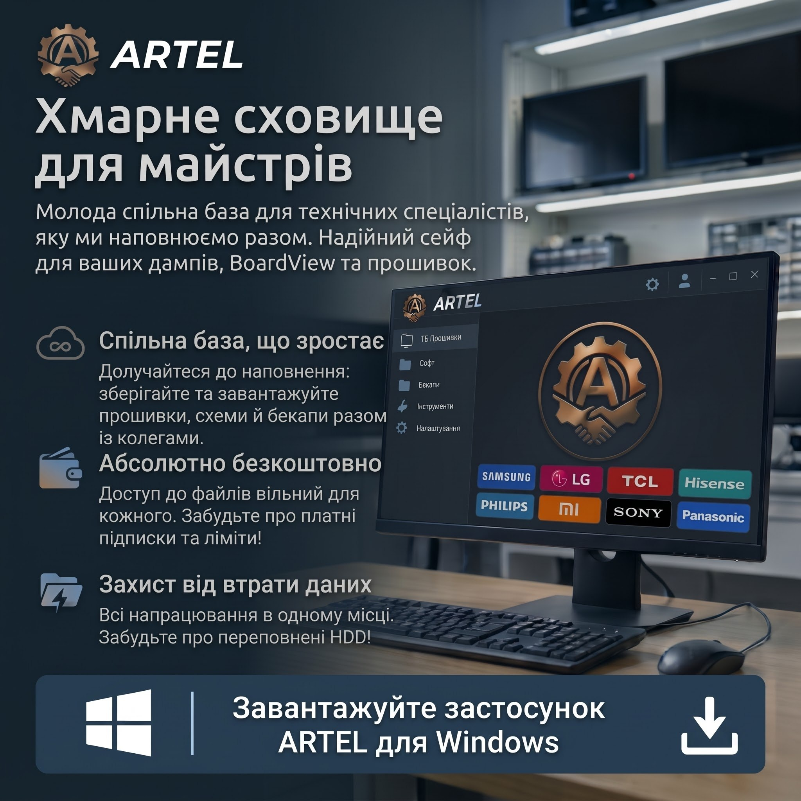

# ARTEL — Masters Knowledge Base

<p><a href="https://tv-firmware.duckdns.org/download/"></a></p>

[ARTEL](https://tv-firmware.duckdns.org) — облачная база прошивок, дампов и
ремонтной документации для мастеров по ремонту электроники. Этот репозиторий —
**десктоп-клиент ARTEL** для Windows 7/8+ (Electron 22 + Rust sidecar).
**[⬇️ Завантажити застосунок](https://tv-firmware.duckdns.org/download/)**

Клиент входит в программу ARTEL для мастеров: общий каталог прошивок,
личное хранилище, чаты сообщества, вкладки инструментов и FAQ.

## Возможности

- 📥 **Загрузка файлов** — файл или целая папка (авто-упаковка в архив),
  7 типов контента: прошивки, документация, софт, даташиты, ISP eMMC,
  фото ремонта, произвольный файл.
- 🔍 **Поиск и каталог** — дерево тип → бренд → модель → шасси, поиск по
  номеру карточки, фильтры.
- ☁️ **Личное хранилище** — личная полка с публикацией в общий каталог,
  отправкой файлов другим мастерам и удалением.
- ⚡ **Передача** — докачивание после обрыва сети, склейка multi-part файлов,
  проверка SHA-256.
- 🗜️ **Архиватор** — локальная упаковка/распаковка (tar.zst, ZIP)
  (zip / tar.zst).
- 💬 **Чаты майстров** — общий чат и обсуждения под каждой карточкой.
- 🌐 **Интерфейс** — украинский, русский, английский.

## Сборка (Linux, кросс-сборка под Windows)

Требования: Node 20+, Rust (targets `x86_64-pc-windows-gnu` и
`i686-pc-windows-gnu`), MinGW-тулчейн, wine (для запуска 32-bit sidecar).

```bash
npm ci
npm run build            # renderer (vite) + electron main (tsc)
cd engine-core
cargo build --release --target i686-pc-windows-gnu
```

TDLib-рантайм (`engine-core/tdlib/windows-{x64,x86}/*.dll`) включён в
репозиторий — клон собирается без дополнительных загрузок.

## Лицензия

GPL-3.0-or-later. Полный текст — [LICENSE](LICENSE).

